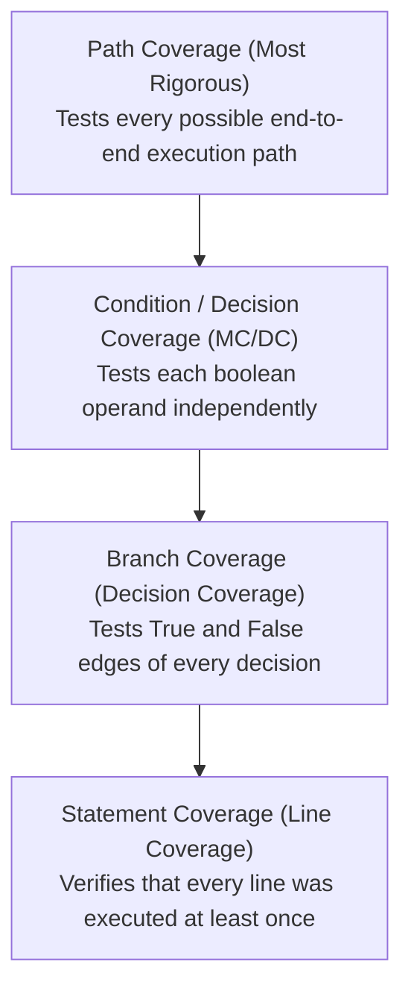

# Code Coverage Analysis in Python with Pytest

**Course:** 192-211 Automated Software Testing  
**Student:** Aeint Kyi Pyar Soe (6705140003)  
**Institution:** Siam University  

---

## Overview

In automated software testing, **Code Coverage** is a quantitative structural testing metric that measures the proportion of source code executed while running an automated test suite. It helps developers and quality assurance engineers identify untested paths, dead code, missing exception handlers, and untested boundary conditions.

However, code coverage can also produce a false sense of security. Achieving **100% Statement Coverage** does not mean that software is defect-free; tests may execute every line of code without exercising every decision branch, input combination, or boolean condition.

This laboratory exercise explores code coverage analysis using Python's `coverage.py` engine and the `pytest-cov` plugin across two real-world case studies:
1. **Parcel Shipping System (`shipping.py`):** Contrasting a weak partial test suite (73% coverage) with a complete test suite (100% statement and branch coverage) that validates exception handling and boundary thresholds.
2. **Access Control Logic (`access.py`):** Demonstrating the **"Illusion of 100% Coverage"** where a weak test suite achieves 100% statement coverage but fails to validate all condition combinations in compound boolean logic (`user_role == "admin" and is_active`).

---

## Directory Structure

```text
Code-Coverage/
├── access.py                  # SUT: Role-based access control with compound boolean logic
├── test_access_weak.py        # Weak suite: 100% statement coverage, incomplete condition coverage
├── test_access_complete.py    # Complete suite: 100% condition / decision coverage (truth table)
├── shipping.py                # SUT: Parcel shipping calculator & free shipping predicate
├── test_shipping.py           # Weak suite: 73% statement coverage (misses errors, heavy surcharge)
├── test_shipping_complete.py  # Complete suite: 100% statement & branch coverage
├── htmlcov/                   # Generated visual HTML coverage reports (ignored by git)
└── README.md                  # Comprehensive code coverage documentation
```

---

## Code Coverage Metrics & Hierarchy

Code coverage operates at multiple levels of rigor. Understanding these levels prevents overconfidence in naive coverage numbers:



### 1. Statement Coverage (Line Coverage)
- **Definition:** The percentage of executable statements executed by the test suite:
  $$\text{Statement Coverage} = \left(\frac{\text{Executed Statements}}{\text{Total Statements}}\right) \times 100\%$$
- **Limitation:** A test suite can achieve 100% statement coverage without testing alternative branches (e.g., an `if` without an `else` when only the `True` path is tested).

### 2. Branch Coverage (Decision Coverage)
- **Definition:** Measures whether each branch of control structures (`if`, `elif`, `else`, `while`, `for`) has been traversed in both directions (`True` and `False`):
  $$\text{Branch Coverage} = \left(\frac{\text{Executed Branches}}{\text{Total Branches}}\right) \times 100\%$$
- Enabled in `pytest` using the `--cov-branch` flag.

### 3. Condition Coverage & Multiple Condition Coverage (MC/DC)
- **Definition:** Evaluates each individual boolean sub-expression within compound conditional statements (e.g., `A and B`).
- Python evaluates compound boolean expressions with **short-circuit evaluation**:
  - For `A and B`: If `A` is `False`, Python immediately returns `False` without evaluating `B`.
  - Testing only `(True, True)` and `(False, False)` satisfies statement and branch coverage, but leaves the state where `A` is `True` and `B` is `False` completely untested!

---

## Case Study 1: Parcel Shipping System (`shipping.py`)

### System Under Test

```python
def calculate_shipping(weight, express=False):
    if weight <= 0:
        raise ValueError("Weight must be a positive number.")
    base = weight * 2
    if express:
        base = base * 1.5
    if weight > 100:
        base = base + 50 # heavy surcharge
    return base

def free_shipping_eligible(order_total):
    return order_total >= 1000
```

### 1. Weak Test Suite (`test_shipping.py`)

```python
from shipping import calculate_shipping

def test_basic_shipping():
    assert calculate_shipping(10) == 20
    
def test_express_shipping():
    assert calculate_shipping(10, express=True) == 30
```

#### Coverage Analysis
Running `pytest` against `test_shipping.py`:
```text
Name          Stmts   Miss  Cover   Missing
-------------------------------------------
shipping.py      11      3    73%   3, 8, 12
-------------------------------------------
TOTAL            11      3    73%
```

#### Deficiencies Identified:
1. **Missing Line 3 (`weight <= 0`):** Negative or zero weights are not tested. If input validation fails or is accidentally removed, the suite cannot detect it.
2. **Missing Line 8 (`weight > 100`):** Heavy parcels subject to the 50-currency surcharge are never exercised.
3. **Missing Line 12 (`free_shipping_eligible`):** The entire qualification function is never invoked.

---

### 2. Complete Test Suite (`test_shipping_complete.py`)

```python
import pytest
from shipping import calculate_shipping, free_shipping_eligible

def test_basic_shipping():
    assert calculate_shipping(10) == 20
    
def test_express_shipping():
    assert calculate_shipping(10, express=True) == 30
    
def test_negative_weight():
    with pytest.raises(ValueError):
        calculate_shipping(-5)
        
def test_heavy_surcharge():
    assert calculate_shipping(150) == 350 # 150 * 2 + 50
    
def test_free_shipping_eligible():
    assert free_shipping_eligible(1000) is True
    assert free_shipping_eligible(1500) is True
```

#### Coverage Analysis
Running `pytest` with `--cov-branch`:
```text
Name          Stmts   Miss Branch BrPart  Cover   Missing
---------------------------------------------------------
shipping.py      11      0      6      0   100%
---------------------------------------------------------
TOTAL            11      0      6      0   100%
```

#### Coverage Comparison Matrix

| Logic Path / Feature | Target Code | `test_shipping.py` (Weak) | `test_shipping_complete.py` (Complete) |
|---|---|:---:|:---:|
| Standard shipping rate | `weight * 2` | Covered | Covered |
| Express shipping multiplier | `express=True` (`* 1.5`) | Covered | Covered |
| Invalid weight validation | `weight <= 0` $\rightarrow$ `ValueError` | **Missed** (Line 3) | **Covered** (`pytest.raises(ValueError)`) |
| Heavy weight surcharge | `weight > 100` $\rightarrow$ `+ 50` | **Missed** (Line 8) | **Covered** (`weight=150`) |
| Free shipping eligibility | `order_total >= 1000` | **Missed** (Line 12) | **Covered** (`1000`, `1500`) |
| **Statement Coverage** | | **73%** | **100%** |
| **Branch Coverage** | | **50%** | **100%** |

---

## Case Study 2: Role-Based Access Control (`access.py`)

### System Under Test

```python
def check_acces(user_role, is_active):
    access = "denied"
    if user_role == "admin" and is_active:
        access = "granted"
    return access
```

### The Pitfall: "The Illusion of 100% Coverage"

Consider the weak test suite `test_access_weak.py`:

```python
from access import check_acces

def test_admin_active():
    assert check_acces("admin", True) == "granted"
    
def test_user_inactive():
    assert check_acces("user", False) == "denied"
```

Running `pytest --cov=access --cov-branch`:
```text
Name        Stmts   Miss Branch BrPart  Cover   Missing
-------------------------------------------------------
access.py       5      0      2      0   100%
-------------------------------------------------------
TOTAL           5      0      2      0   100%
```

> [!WARNING]
> Even though both statement coverage and branch coverage report **100%**, the test suite is fundamentally flawed!
> 
> Due to Python's **short-circuit evaluation**, in `check_acces("user", False)`:
> 1. `user_role == "admin"` evaluates to `False`.
> 2. Python aborts evaluation and does not inspect `is_active`.
> 
> If a developer introduces a critical security defect by omitting `and is_active`:
> ```python
> if user_role == "admin":  # Security flaw: inactive admins granted access!
>     access = "granted"
> ```
> `test_access_weak.py` **still passes 100%**, letting an unauthorized inactive admin bypass security checks!

---

### Complete Condition Coverage (`test_access_complete.py`)

To eliminate the flaw, all 4 permutations of the compound boolean condition must be tested:

```python
from access import check_acces

def test_admin_active_granted():
    assert check_acces("admin", True) == "granted"
    
def test_admin_inactive_denied():
    assert check_acces("admin", False) == "denied"

def test_non_admin_active_denied():
    assert check_acces("user", True) == "denied"
    
def test_non_admin_inactive_denied():
    assert check_acces("user", False) == "denied"
```

#### Truth Table & Condition Verification (MC/DC)

| Test Function | `user_role == "admin"` | `is_active` | Compound (`and`) | Expected Output | Tested in Weak Suite? | Tested in Complete Suite? |
|---|:---:|:---:|:---:|:---:|:---:|:---:|
| `test_admin_active_granted` | **True** | **True** | **True** | `"granted"` | Yes | **Yes** |
| `test_admin_inactive_denied` | **True** | **False** | **False** | `"denied"` | **No (Vulnerability gap!)** | **Yes** |
| `test_non_admin_active_denied` | **False** | **True** | **False** | `"denied"` | **No** | **Yes** |
| `test_non_admin_inactive_denied` | **False** | **False** | **False** | `"denied"` | Yes (Short-circuited) | **Yes** |

---

## Code Coverage Tooling & Reports

This module leverages two industry-standard tools:
- **`coverage.py`**: The core Python code coverage engine that monitors CPython execution bytecode.
- **`pytest-cov`**: The official pytest plugin integrating `coverage.py` directly into pytest test execution.

### Generating Terminal Reports

Pass `--cov` targeting the module or package, and `--cov-report=term-missing` to highlight line numbers of missed statements:

```bash
python -m pytest test_shipping.py --cov=shipping --cov-report=term-missing
```

### Measuring Branch Coverage

Add `--cov-branch` to track decision outcomes:

```bash
python -m pytest test_shipping_complete.py --cov=shipping --cov-report=term-missing --cov-branch
```

### Generating Interactive HTML Reports

Generate a browsable HTML report in the `htmlcov/` folder:

```bash
python -m pytest test_shipping_complete.py --cov=shipping --cov-report=html
```

Open `htmlcov/index.html` in any web browser to view:
- Per-file statement and branch percentages
- Color-coded source code:
  - <span style="color:green; font-weight:bold;">Green:</span> Executed statements
  - <span style="color:red; font-weight:bold;">Red:</span> Missed / unexecuted statements
  - <span style="color:orange; font-weight:bold;">Yellow:</span> Partial branches (e.g., condition evaluated True but never False)

---

## How to Run Tests & Coverage Reports

### 1. From the Repository Root

```bash
# Run all tests in the Code-Coverage folder
python -m pytest Code-Coverage -v

# Run full coverage analysis across both modules
python -m pytest Code-Coverage --cov=Code-Coverage --cov-report=term-missing --cov-branch

# Run individual test files with targeted module coverage
python -m pytest Code-Coverage/test_shipping.py --cov=shipping --cov-report=term-missing
python -m pytest Code-Coverage/test_shipping_complete.py --cov=shipping --cov-report=term-missing --cov-branch
python -m pytest Code-Coverage/test_access_weak.py --cov=access --cov-report=term-missing --cov-branch
python -m pytest Code-Coverage/test_access_complete.py --cov=access --cov-report=term-missing --cov-branch
```

### 2. From Within the `Code-Coverage` Directory

```bash
cd Code-Coverage

# Run weak shipping tests (shows 73% coverage with missing lines 3, 8, 12)
python -m pytest test_shipping.py --cov=shipping --cov-report=term-missing

# Run complete shipping tests (achieves 100% statement & branch coverage)
python -m pytest test_shipping_complete.py --cov=shipping --cov-report=term-missing --cov-branch

# Run complete access control tests (verifies full condition truth table)
python -m pytest test_access_complete.py --cov=access --cov-report=term-missing --cov-branch

# Generate visual HTML report
python -m pytest test_shipping_complete.py --cov=shipping --cov-report=html
```

---

## Key Takeaways & Best Practices

1. **Coverage Measures What Was Run, Not What Was Verified:**  
   Code coverage only confirms that a line of code was touched by the interpreter during execution. It does **not** ensure that the assertions are valid, strict, or comprehensive.
2. **Beware the 100% Coverage Myth:**  
   As demonstrated in `test_access_weak.py`, 100% statement and branch coverage can easily mask untested conditions, security vulnerabilities, and short-circuit evaluation side-effects.
3. **Combine Coverage with Specification-Based Techniques:**  
   Code coverage should be treated as a discovery tool to locate unexecuted code, not as a target metric. It must always be paired with:
   - **Boundary Value Analysis (BVA)** (e.g., testing `weight = 100` and `weight = 101`)
   - **Equivalence Partitioning**
   - **Negative Testing & Exception Verification** (`pytest.raises`)
4. **Always Enable Branch Coverage (`--cov-branch`):**  
   Plain statement coverage often obscures unexercised `else` or exception branches in branching logic.
